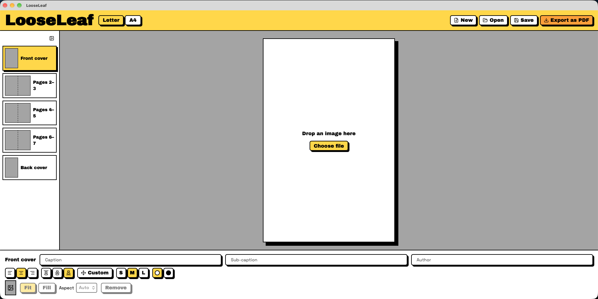

<div align="center">

<h1>LooseLeaf</h1>

<h3>Heavily inspired by <a href="https://dirtylittlezine.com">DirtyLittleZine</a> by Rick Vega</h3>

<p>Fast, efficient and secure desktop app to turn single sheets of paper into photo zines.</p>

[](https://tauri.app)
[](https://svelte.dev)
[](https://www.rust-lang.org)
[](LICENSE)

</div>

<p align="center"></p>


## Features

- **One sheet, eight pages** — lay out a classic single-sheet, one-cut, eight-page zine
- **Paper sizes** — US Letter and A4
- **Photo import** — drop in your images; EXIF orientation is handled automatically
- **Cover captions** — title, sub-caption and author on the cover
- **Print-ready PDF export** — pages are composited onto a single sheet in the correct fold order
- **Local and private** — everything runs on your machine; nothing is uploaded

## How it works

LooseLeaf arranges your eight pages on one side of a sheet so that, once printed, it folds into a booklet:

```
┌──────┬──────┬──────┬──────┐
│  5   │  4   │  3   │  2   │ 
│ (↓)  │ (↓)  │ (↓)  │ (↓)  │
├──────┼──────┼──────┼──────┤
│  6   │  7   │ Back │Cover │
└──────┴──────┴──────┴──────┘
```

1. Print the exported PDF.
2. Fold in half lengthwise, then in quarters widthwise.
3. Cut along the center crease between the middle panels.
4. Open it out, push the middle together and fold it into a booklet.

Prefer to watch? Alison Spence Montillet shows the whole fold process here:

[](https://youtu.be/MKM3PfFhsbQ)

## Getting started

### Prerequisites

- [Node.js](https://nodejs.org) (LTS)
- [Rust](https://www.rust-lang.org/tools/install)
- Tauri's [system dependencies](https://tauri.app/start/prerequisites/) for your OS

### Run in development

```sh
cd looseleaf
npm install
npm run tauri-dev
```

### Build a release

```sh
cd looseleaf
npx tauri build
```

Type-check the frontend with `npm run check`.

## Acknowledgements

LooseLeaf wouldn't exist without [DirtyLittleZine](https://dirtylittlezine.com) by Rick Vega. If you'd rather make a zine in your browser, go check it out.

## License

Licensed under the [GNU General Public License v3.0](LICENSE).
